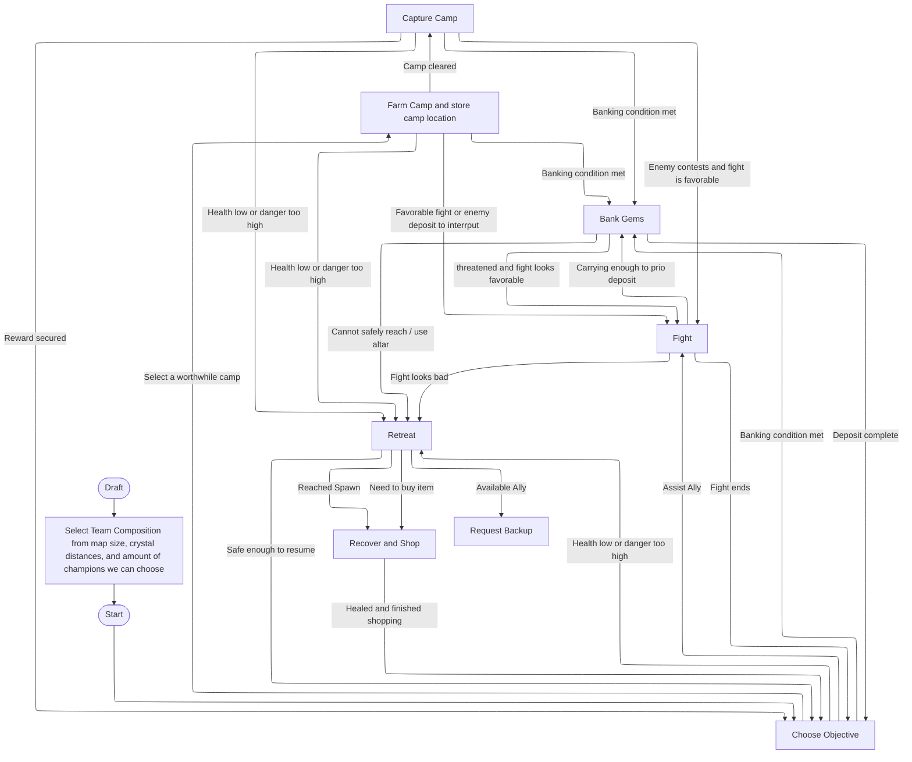

# Lucky Gold Clusters
Cambridge Battlecode 2026 Code Base

Current running bot: "bots/newest-bot"

## Todo/things that might be useful:
- Improve pathfinding.
    - Manually implement algorithm (dijkstra, A* or some other) for path finding instead of using SDK's floodfill alg. We want to make use of Teleport Crystals. They can be useful for some maps where an alter is surrounded by walls or a whole wall divides the map into two. Teleport Crystal is a consumable, so champions(except Tavi) need to recall if they teleport into a cage or smth.
- Champion decisions. (Improve drafting phase)
    - Currently we select champions by looking at map and champion parameters. This method does not look at how champions can combine togther. One alternative method we discussed is to have some hard-coded combinations of champions, and at the drafting phase the code will decide the combination based on map.
- Micro
    - If a champion sees a fighting teamate and an alter simultaneously, what does it do.  
- Macro (Maybe)
    - In some games the enemy gets much more gold coins. So despite being at disadvantage (lower gems) in the start, they eventually get many emblems and win. We should plan when to emphasize coins and when not to. 

# Current Strategy
During drafting phase, the code determines if the enemies will meet up. If the enemy spawns are so far that they have their own alters and gem camps, and fighting is not necessary, then the map is `sparse`. For this case, we only need to figure out how to farm 1000 gems in the shortest time. Otherwise,  

