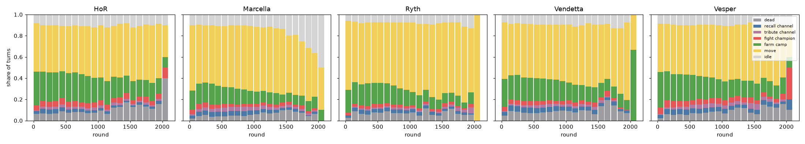
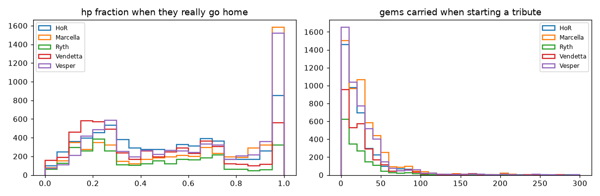
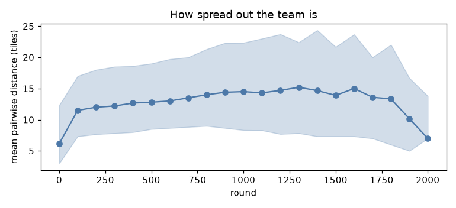

# print dont int: how they play

Built from 500 replays (500 downloaded, newest first) by `training/macro_report.py`.

## Results

- Record: **385 W / 115 L** (77%)
- unranked: 357 W / 98 L
- ranked: 28 W / 17 L
- End reasons: gems 490, tiebreak_gems 10
- Game length: median 982 rounds (p10 588, p90 1511)

Weakest maps (W/L):

- 00expanse: 0/10
- 01gold_rush: 0/4
- 02tangle: 1/6
- 01corridors: 2/4
- 02geodes: 2/3
- 00dunes: 2/2
- 01the_farm: 2/2
- 00stampede: 3/3

Most frequent opponents (W/L):

- error404: 113/12
- Trzy Kwaterki: 44/46
- Olympus: 28/12
- procless: 26/4
- Bamboo Teahouse: 24/1
- Team USA🇺🇸: 20/0
- SSSA: 19/1
- Claudus Maximus: 7/8
- Supaswag: 10/5
- Mite: 11/4

## Draft

Pick order (draft ids) and how often:

- Vesper > HoR > Vendetta > Ryth > Marcella: 307
- Vesper > HoR > Vendetta > Marcella: 116
- Vesper > Marcella > HoR: 77

## How each hero spends its turns

| hero | dead | recall channel | tribute channel | fight champion | farm camp | move | idle |
|---|---|---|---|---|---|---|---|
| HoR | 8% | 3% | 2% | 5% | 26% | 46% | 10% |
| Marcella | 5% | 4% | 3% | 4% | 16% | 58% | 11% |
| Ryth | 7% | 3% | 1% | 3% | 18% | 60% | 7% |
| Vendetta | 8% | 4% | 2% | 4% | 21% | 52% | 9% |
| Vesper | 7% | 4% | 3% | 5% | 23% | 48% | 10% |

## Recalls and tributes

They start a recall at the end of most turns and cancel it at the start of the next turn if they want to act (a *speculative* recall: the first channel tick is free if they decide to go home). Below, only recalls that really brought the champion home (it reappears on its spawn).

| hero | trips home / game | median hp at trip | median gems carried | median gold | tributes / game | median gems per tribute | median first tribute round |
|---|---|---|---|---|---|---|---|
| HoR | 13.1 | 0.49 | 0 | 27 | 8.1 | 14 | 167 |
| Marcella | 11.7 | 0.68 | 0 | 105 | 10.6 | 21 | 125 |
| Ryth | 10.6 | 0.41 | 0 | 14 | 5.3 | 14 | 229 |
| Vendetta | 13.6 | 0.40 | 0 | 17 | 6.8 | 18 | 212 |
| Vesper | 13.4 | 0.60 | 0 | 62 | 9.9 | 16 | 124 |

## Item builds

Most bought items per hero (shards; emblems complete automatically every 5), and the most common opening sequence of the first 8 purchases:

- **HoR**: treasure_foc 877, power_foc 829, home_hp 685, tp_crystal 609, durability_hp 569, bruiser_foc 517, bruiser_hp 483, altar_lock 472
  - opening (31/496 games): treasure_foc > altar_lock > treasure_foc > power_foc > power_foc > home_hp > home_hp > durability_hp
- **Marcella**: bruiser_foc 1766, durability_hp 867, treasure_foc 708, tp_crystal 691, monster_foc 655, jungle_hp 604, prospector_foc 578, capture_foc 560
  - opening (16/497 games): treasure_foc > durability_hp > altar_lock > durability_hp > prospector_foc > prospector_foc > monster_foc > monster_foc
- **Ryth**: treasure_hp 530, durability_hp 384, tp_crystal 317, jungle_hp 284, altar_lock 261, monster_str 239, prospector_str 229, bruiser_str 185
  - opening (7/289 games): treasure_hp > altar_lock
- **Vendetta**: treasure_str 804, durability_hp 666, bruiser_str 558, tp_crystal 531, bruiser_hp 507, jungle_hp 451, monster_str 428, altar_lock 389
  - opening (8/410 games): treasure_str > altar_lock
- **Vesper**: bruiser_str 1694, bruiser_hp 1637, power_str 779, treasure_str 696, tp_crystal 678, durability_hp 673, monster_str 535, jungle_hp 491
  - opening (15/479 games): treasure_str > power_str > altar_lock > power_str > durability_hp > durability_hp > prospector_str > prospector_str

## Targets

| hero | attacks: camps vs champions | camp types hit | in-range pick: lowest hp / nearest / other |
|---|---|---|---|
| HoR | 100522 / 25390 (locks 1045) | wolf 51%, elk 31%, gem 9%, gold 7%, golem 2%, monolith 1% | 23% / 54% / 23% |
| Marcella | 92259 / 16037 (locks 1346) | wolf 39%, elk 30%, gem 14%, gold 13%, golem 3%, monolith 2% | 20% / 41% / 39% |
| Ryth | 62841 / 10327 (locks 357) | wolf 47%, elk 36%, gold 8%, gem 5%, golem 3%, monolith 1% | 17% / 48% / 35% |
| Vendetta | 85040 / 19243 (locks 639) | wolf 44%, elk 31%, gold 11%, gem 11%, golem 2%, monolith 1% | 13% / 46% / 41% |
| Vesper | 102318 / 29881 (locks 912) | wolf 40%, elk 32%, gem 12%, gold 10%, golem 3%, monolith 3% | 14% / 18% / 68% |

## Abilities

- **HoR**: slot1_type6 42164, slot0_type7 21687
  - dashes: away 30778, away (enemy near) 5059, home 3704, home (enemy near) 1412, away (enemy near) low hp 568, home (enemy near) low hp 296, away low hp 265, home low hp 82
- **Marcella**: slot1_type2 20304, slot0_type1 17618
- **Ryth**: slot0_type3 11576, slot1_type1 11419
- **Vendetta**: slot1_type6 23469, slot0_type1 21908
  - dashes: away 16985, away (enemy near) 2757, home 1656, home (enemy near) 965, away (enemy near) low hp 537, home (enemy near) low hp 436, away low hp 94, home low hp 39
- **Vesper**: slot1_type6 29766, slot0_type1 25667
  - dashes: away 19994, away (enemy near) 5303, home 1989, home (enemy near) 1491, away (enemy near) low hp 494, home (enemy near) low hp 373, away low hp 71, home low hp 51

## Teleports, wards, deaths

| hero | teleports / game | median gems when teleporting | median hp | wards near altar / elsewhere | deaths / game |
|---|---|---|---|---|---|
| HoR | 1.09 | 4 | 1.00 | 4213 / 11608 | 1.36 |
| Marcella | 1.24 | 8 | 1.00 | 4261 / 10395 | 0.81 |
| Ryth | 0.97 | 0 | 1.00 | 2117 / 6249 | 1.19 |
| Vendetta | 1.16 | 4 | 1.00 | 2852 / 9011 | 1.34 |
| Vesper | 1.25 | 7 | 1.00 | 4285 / 10913 | 1.15 |

